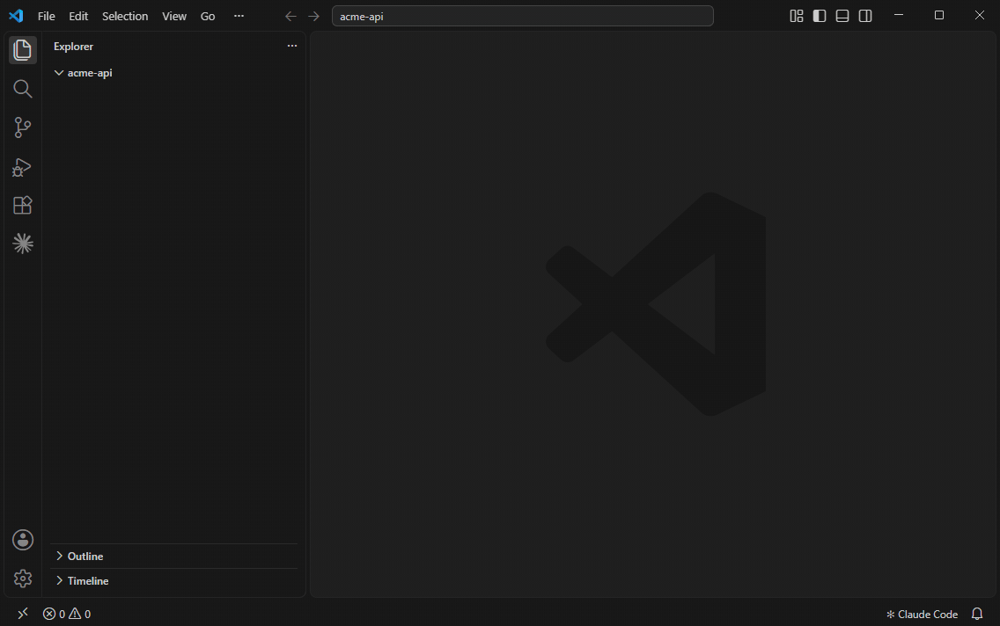

# Session Finder for Claude Code

Find any past Claude Code conversation by **what was said in it**, not by its auto-generated title, then **resume it in the Claude Code panel** with one keystroke.

Claude Code's own "Search sessions" box only matches titles and only shows the folder that's open right now. This extension searches the full text of every session on your machine, across all projects.

## Features

- **Full-text search across all projects.** Covers every message you and Claude wrote in every `~/.claude/projects/**/*.jsonl` session.
- **One-click resume.** Press <kbd>Enter</kbd> and the session reopens in the official Claude Code panel.
  - If the session belongs to another folder, the extension offers to open that folder in a new window and resumes the session there automatically.
  - You can also resume in a terminal (`claude --resume <id>`) instead.
- **Live results as you type**, with a snippet around the match, the project name, the git branch, and how long ago the session was active.
- **Transcript view.** Opens the whole conversation as Markdown and jumps to the match.
- **Case- and accent-insensitive.** `calisma` finds *Çalışma*, `istanbul` finds *İstanbul*.
- **Local and private.** No network calls and no telemetry. The index is cached in VS Code's own extension storage.

## Usage

Open the Command Palette and run **Session Finder: Search Claude Sessions**, or press
<kbd>Ctrl</kbd>+<kbd>Alt</kbd>+<kbd>Shift</kbd>+<kbd>F</kbd> (<kbd>Cmd</kbd>+<kbd>Alt</kbd>+<kbd>Shift</kbd>+<kbd>F</kbd> on macOS).

| Query | Meaning |
|---|---|
| `redis timeout` | sessions containing **all** words (anywhere in the session) |
| `"connection refused"` | exact phrase |
| `-docker` | exclude sessions that mention *docker* |
| `project:3dnet` | only sessions whose folder path contains *3dnet* |
| `role:user` / `role:claude` | match only your messages / only Claude's |
| `/err(or)?\s+42/` | JavaScript regular expression |

The buttons on each result open the transcript at the match, resume in a terminal, copy the session ID, or open the raw `.jsonl` file.
The buttons in the title bar switch between **all projects** and **this workspace**, and rebuild the index.

Other commands:

- **Search Claude Sessions in This Workspace**
- **Resume Session by ID…**
- **Rebuild Index**

## Settings

| Setting | Default | |
|---|---|---|
| `sessionFinder.resumeTarget` | `panel` | `panel` = Claude Code extension, `terminal` = `claude --resume` |
| `sessionFinder.includeToolContent` | `false` | Also index tool calls and tool output (commands, paths, logs) |
| `sessionFinder.claudeConfigDirs` | `[]` | Extra or alternative Claude config dirs. Empty = `$CLAUDE_CONFIG_DIR` or `~/.claude` |
| `sessionFinder.terminalCommand` | `claude --resume ${sessionId}` | Command used for terminal resume |
| `sessionFinder.persistIndex` | `true` | Cache extracted text for instant startup |
| `sessionFinder.maxResults` | `200` | Result limit |

## How resume works

The Claude Code extension handles `vscode://anthropic.claude-code/open?session=<id>`, and Session Finder opens that URI.
Claude Code only resumes a session from the folder it was created in. So when you pick a session from another project, Session Finder opens that folder first. A one-time "pending resume" note in its storage tells the new window which session to open.

## What gets indexed

- Indexed: your prompts, Claude's replies, session titles (`/rename`, AI titles, summaries), folder, branch, and timestamps.
- Not indexed by default: tool calls and tool output (turn on with `includeToolContent`).
- Never indexed: thinking blocks, system reminders, subagent transcripts, and empty sessions.

Remote/WSL/SSH: the extension runs on the same side as Claude Code, so it indexes the sessions of the machine your workspace is on.

## Limitations

- Claude Code's transcript format is undocumented and may change. The parser is deliberately tolerant, but please open an issue if a new version breaks it.
- Cloud sessions (claude.ai/code, Claude desktop Cowork) are not stored as local `.jsonl` files and are not searchable.

## Disclaimer

This is an independent community extension. It is not affiliated with or endorsed by Anthropic. "Claude" and "Claude Code" are trademarks of Anthropic.
